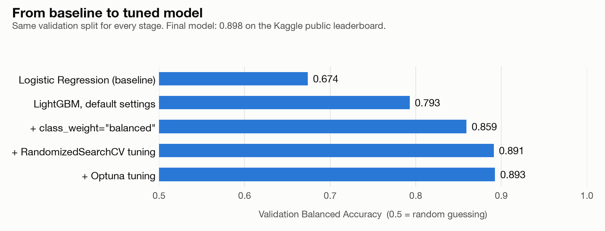

# Customer Churn Prediction

**Predicting which telecom customers will leave, using LightGBM, class balancing, hyperparameter tuning and targeted feature engineering.**

**Result: 0.898 Balanced Accuracy on the Kaggle public leaderboard** (course competition).

[📓 View the notebook](customer_churn_prediction.ipynb) · [Open in Google Colab](https://colab.research.google.com/drive/1sqivMZRNqCGqA9uaxvY6KuytZkqfgmtx)

## The problem

Keeping a customer is cheaper than finding a new one, so companies want to know in advance who is likely to leave.

The dataset contains **10,000 anonymized telecom customers** with **230 features** (numerical and categorical), many with heavy missing values. Only **~13% of customers churn**, so a model that always predicts "stays" would already be 87% accurate. That's why the project uses **Balanced Accuracy**, which gives equal weight to both classes.

## How the model improved

1. **Baseline.** Logistic Regression in a scikit-learn pipeline: 0.674.
2. **Model comparison.** Seven ensemble models on the same split. LightGBM was both the most accurate (0.793) and the fastest to train (1.3 s vs 104 s for CatBoost).
3. **Class imbalance.** `class_weight="balanced"` beat SMOTE (0.859 vs 0.803) and became the default.
4. **Hyperparameter tuning.** RandomizedSearchCV (0.891), then Bayesian optimization with Optuna (0.893).
5. **Decision threshold.** The probability threshold was tuned on out-of-fold predictions; the best value was around 0.30 instead of the default 0.50.
6. **Feature engineering.** Missing-value indicators and quartile flags for the most important features, chosen after feature-importance and error analysis.

The final submission (LightGBM with class weighting, 212 input columns, 12 quartile flags and a 0.30 threshold) scored **0.8977** on the Kaggle public leaderboard.

## What didn't work

Negative results are part of the process:

| Experiment | Outcome |
| --- | --- |
| Dimensionality reduction with TruncatedSVD | Balanced Accuracy dropped to 0.509 |
| Removing features with > 35% missing values | 0.891 → 0.877: incomplete features still carry signal |
| SMOTE oversampling | Weaker than class weighting (0.803 vs 0.859) |
| Soft-voting ensemble of two LightGBM models | Lower out-of-fold score than a single model (0.884 vs 0.888) |
| Missing indicators + missing-count feature together | Better locally, worse on the public leaderboard (0.879) |

## Analysis beyond the score

- **EDA:** feature types, missing-value patterns, categorical cardinality, target imbalance, correlations with the target.
- **Correlated features:** 82 pairs of numerical features with |r| > 0.95; removing near-duplicates (|r| > 0.99) slightly improved the model.
- **Feature importance:** how concentrated the model's attention is across features.
- **Error analysis:** false positives and false negatives compared with correctly classified customers to find patterns for new features.
- **Matched comparison:** cross-validation with and without the quartile flags, to check whether they really help. They did not add a measurable gain on their own (0.8817 vs 0.8812), which shows how easy it is to overfit to a validation set.

## Tools

Python · pandas · NumPy · scikit-learn · LightGBM · XGBoost · CatBoost · imbalanced-learn · Optuna · Matplotlib · Seaborn · Google Colab

## How to run

1. Open the notebook in [Google Colab](https://colab.research.google.com/drive/1sqivMZRNqCGqA9uaxvY6KuytZkqfgmtx).
2. Run all cells from top to bottom. The first cells install the dependencies, and the data loads automatically from the [GoIT course repository](https://github.com/goitacademy/MACHINE-LEARNING-NEO/tree/main/competition).

Hyperparameter search and cross-validation take a while. The notebook keeps its saved outputs, so all results can be read without rerunning it.

---

Built by **Iryna Zvirkovska** as the final project of the Machine Learning course (MSc Computer Science, Woolf / Neoversity) · [GitHub](https://github.com/irenezvirkovska-hue) · [LinkedIn](https://www.linkedin.com/in/iryna-zvirkovska/)
